# Favorite

_Original URL: https://ikengala.squarespace.com/home/favorite_

*Favorite* (released April 2026) is not so much a strategy case study but rather a *validation* case study. Throughout the course of the BCZIKN project, one of my biggest challenges has been figuring out how to market East African-made music as more than the geographic label that precedes it. Especially in the beginning of this project, songs would be routinely filed alongside other “*Afro*-[X]” tags (afro-indie, afro-R&B, afro-acoustic), regardless of whether the song actually belonged to that genre, or whether its audience was even based in Africa to begin with.

*Favorite* is, to date, the clearest evidence yet that this is starting to shift; upon release, the single saw an editorial sweep from both regional outlets and international R&B outlets. No new tactic has driven this result - instead, it is a consistent identity and brand messaging finally being read correctly by editorial curators, instead of filtered through a geographic label first.

### Consistent Press Messaging

For the last few years that the project has been ongoing, the same position has been held: that East African music doesn’t have to sound “African” to be considered East African, and furthermore, that East Africans ***can and do* **make music that isn’t simply Afro-derivative. Furthermore, that the music industry has yet to make room for African artists whose work doesn’t fit a stereotyped, genre-coded idea of what “African” music is supposed to sound like. Favorite’s reception is the clearest sign thyet that this position is starting to be heard.

[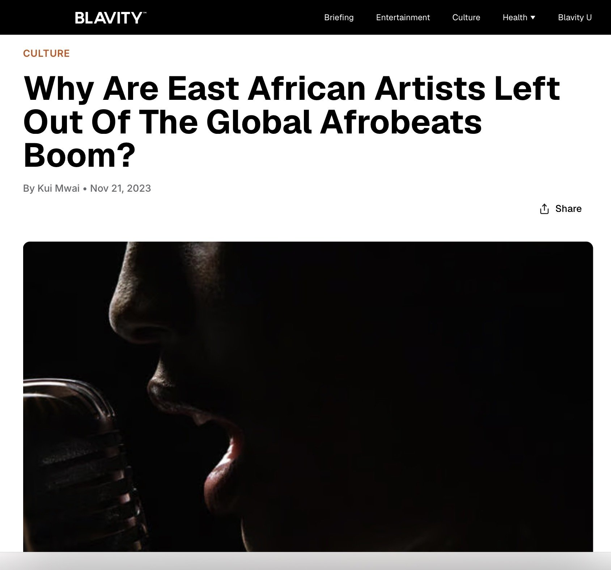](https://blavity.com/blavity-original/east-african-artists-afrobeats)

[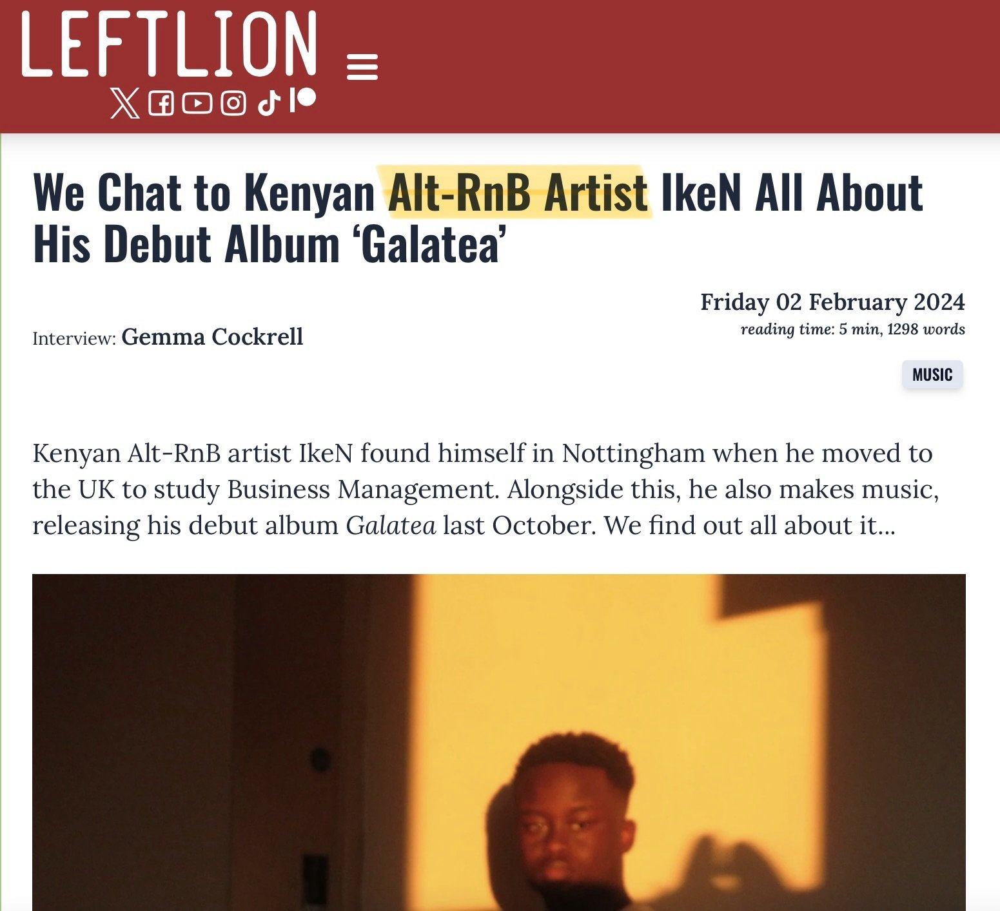](https://leftlion.co.uk/features/2024/02/we-chat-to-kenyan-alt-rnb-artist-iken-all-about-his-debut-album-galatea/)

[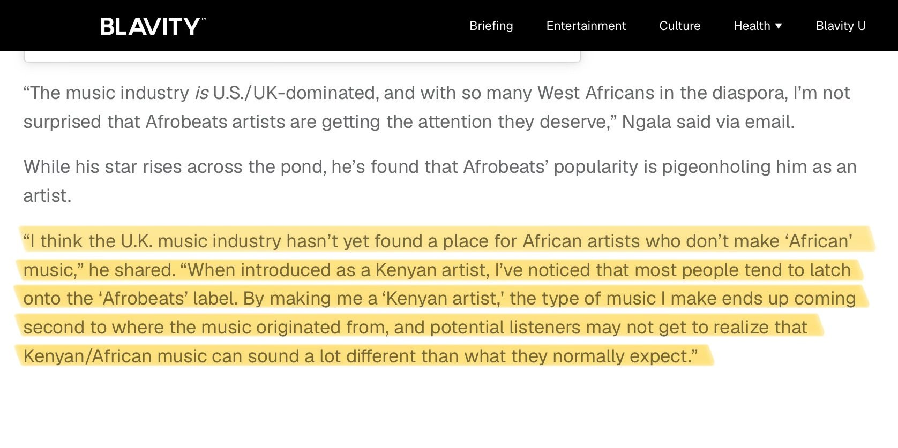](https://blavity.com/blavity-original/east-african-artists-afrobeats)

[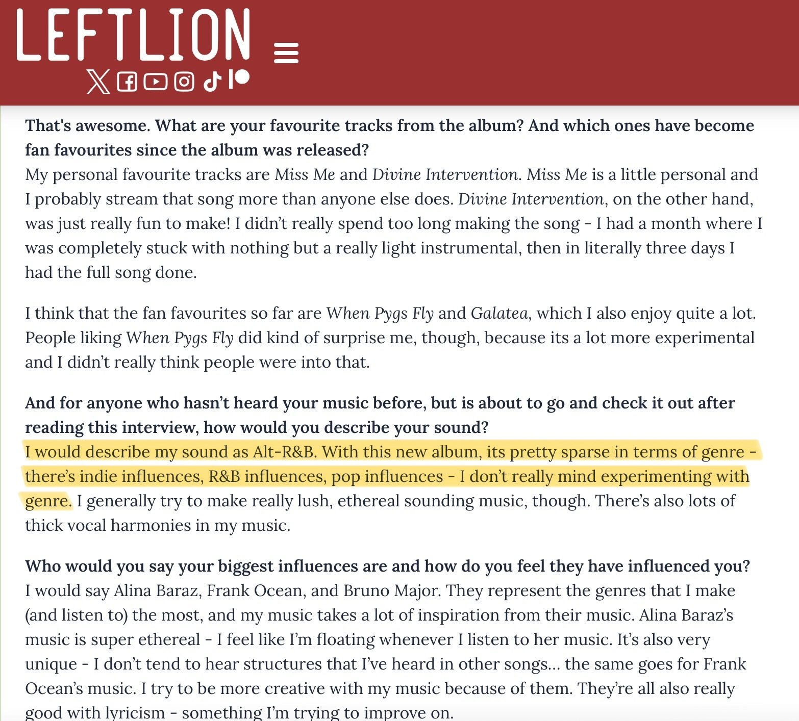](https://leftlion.co.uk/features/2024/02/we-chat-to-kenyan-alt-rnb-artist-iken-all-about-his-debut-album-galatea/)

[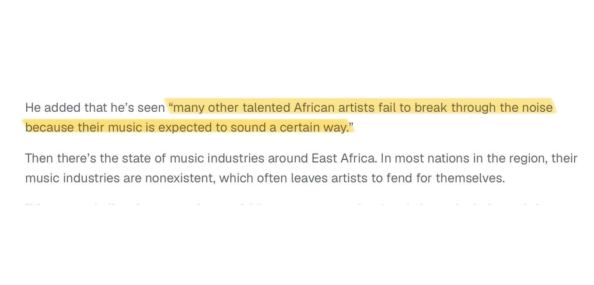](https://blavity.com/blavity-original/east-african-artists-afrobeats)

[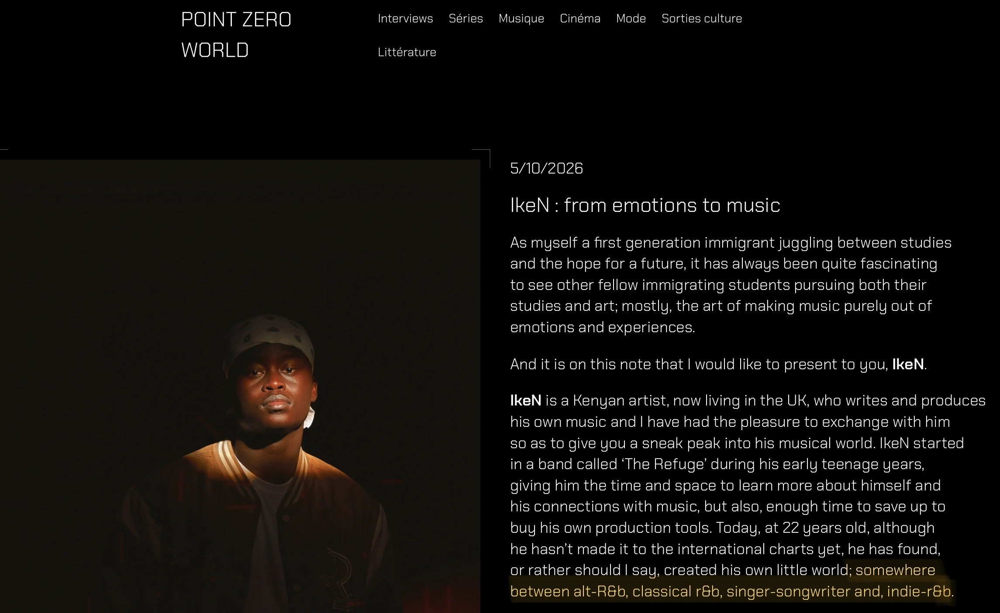](https://pointzeroworld.com/2026/05/10/iken-from-emotions-to-music/?utm_source=ig&utm_medium=social&utm_content=link_in_bio)

## Outcomes

**Reach + Editorial Coverage**

*Favorite* was quite successful, racking up 10,000 streams in 3 days. By the end of the release period, IkeN sat at 27K monthly listeners.

The song landed a wide editorial sweep, from local recognition - **New Music Friday Kenya** - to wider regional playlisting - **New Music Friday Naija** (Nigeria), **New Music Friday South Africa**, **Barefoot and Free** (wider Africa vibes playlist), and **Afro&B** (wider African R&B playlist) - to international editorial recognition **R&B Right Now** (Canadian/Global R&B playlist), **Just Dropped** (new UK arrivals), and **New Music Friday UK**, showcasing the shift from Spotify’s editorial system reading IkeN as a cross-regional/internationally appealing artist instead of a regional one.

**Gallery (reel)**

- 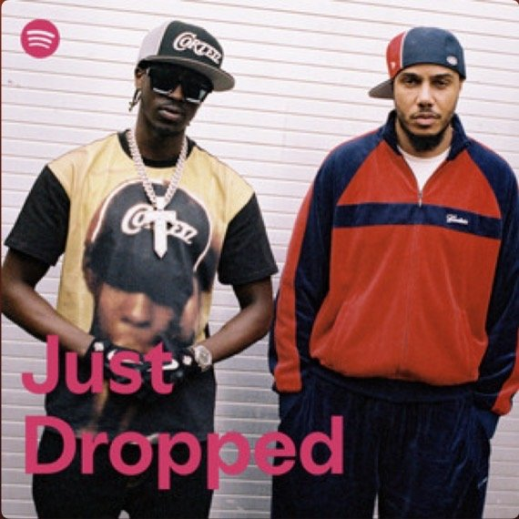

- 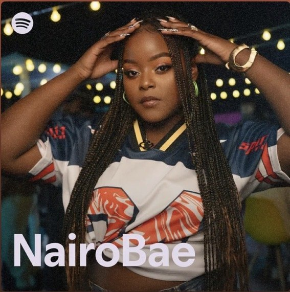

- 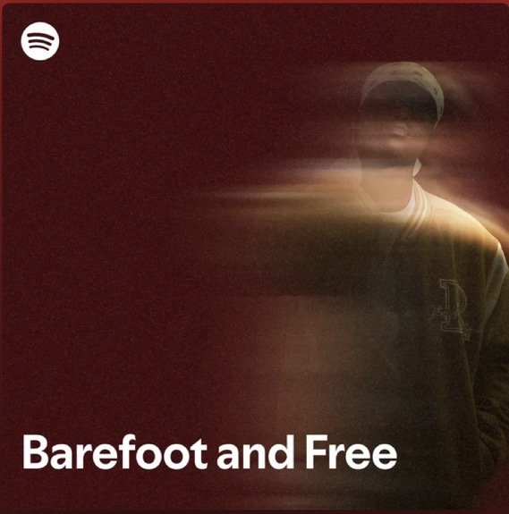

- 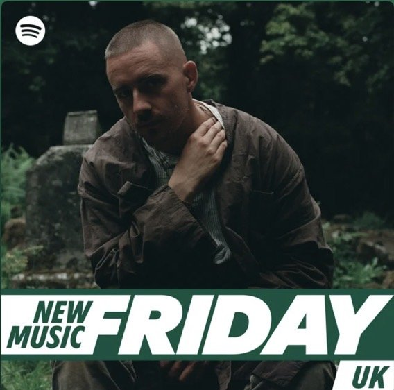

- 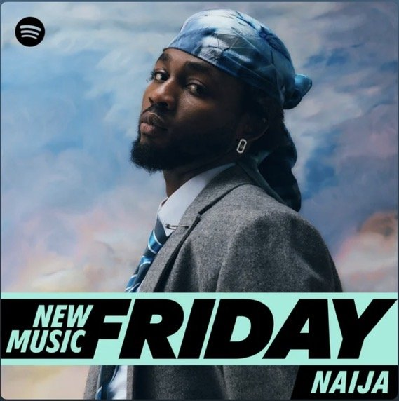

- 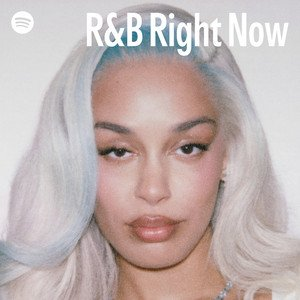

- 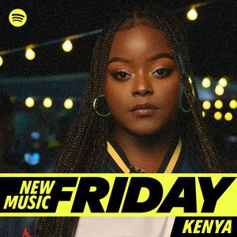

- 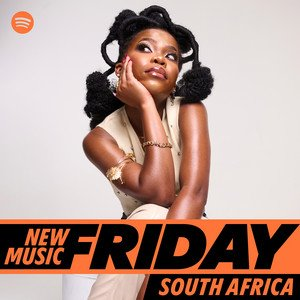

- 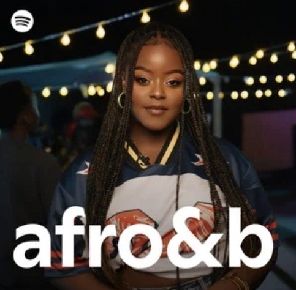
