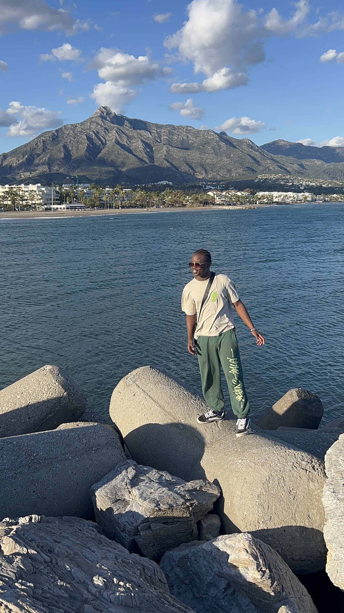
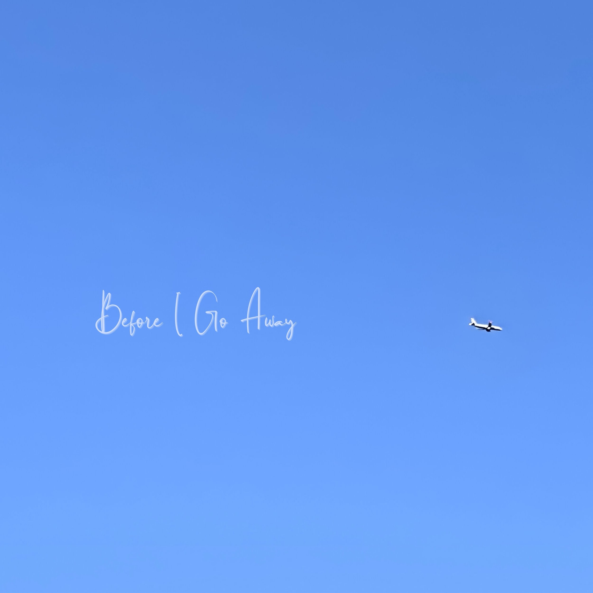
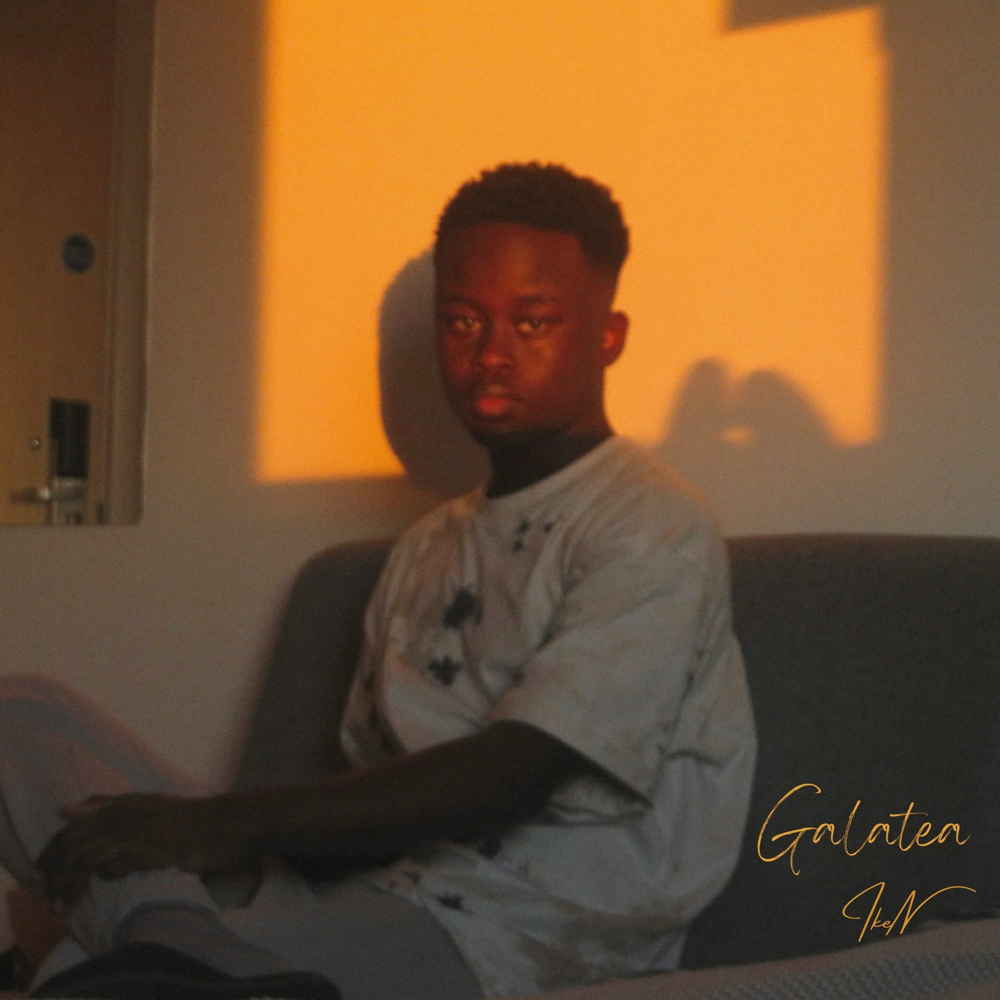
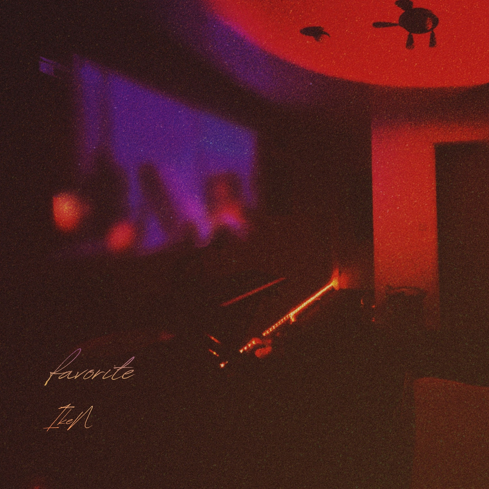

# Ike Ngala | Marketing Portfolio

_Original URL: https://ikengala.squarespace.com/_

# Ike Ngala

### Marketing Portfolio

Hi, I’m Ike!

I’m a Management graduate specializing in brand strategy and audience growth.

Academically, I’ve built a strong grounding in marketing theory and management fundamentals, and have also spent the last few years running the full marketing function for a self-directed project: content strategy, press relations, audience growth, brand positioning, and audience data analysis. I am currently sharpening that analytical edge further with Meta Blueprint and Google Analytics 4 certifications.

I believe I bring optimism, energy, creative instinct, and real-world experience with dealing with marketing projects & campaigns!

# Introducing

Over the last few years, I have built and run the marketing, content, and distribution strategy for my independent music project that has reached listeners in 165+ countries. This includes engineering viral moments that have become sustained, compounding growth, and landing simultaneous editorial placements over four continents. This project is the spine of this portfolio: Three campaigns, each showcasing a different area of growth; virality, press, and long-form brand building.

## Projects

- [Before I Go Away](../projects/before-i-go-away.html) (cover: )

- [Galatea](../projects/galatea.html) (cover: )

- [Favorite](../projects/favorite.html) (cover: )

## My Skills & Tools

